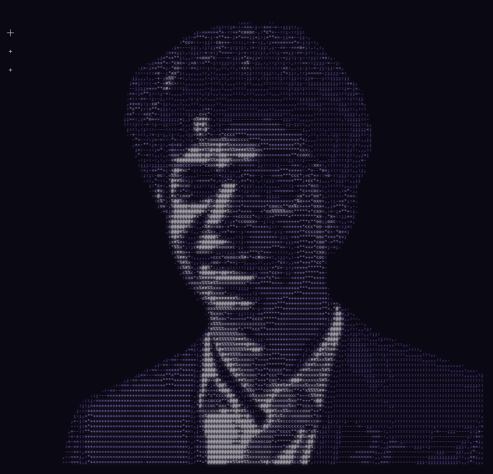

  

<h1 align="center">Eyad Elnakib</h1>

  

  
  
  

---

### About me

- AI and Machine Learning Engineer focused on **computer vision, LLMs, RAG and generative AI**.
- I build production-ready AI and integrate it into full-stack web apps — from data and model to deployment and the interface people use.
- B.Sc. in **Artificial Intelligence Engineering**, Alamein International University, Egypt.
- Coach and mentor: **ICPC** coach for 53 students, **IEEE** Machine Learning & Neural Networks coach for 100+ students.

### Featured projects

| Project | What it does | Built with |
|---|---|---|
| **[Atelier](https://github.com/Eyad-Elnakib1/Atelier)** · [live](https://atelier-two-omega.vercel.app) | Clothes segmentation and outfit restyling: every garment found pixel by pixel, cut out, and re-dyed in new colours or 12 fabrics. Test mIoU 0.789. | SegFormer-B3, PyTorch, FastAPI, React |
| **[Automated Transit Safety Platform](https://github.com/Eyad-Elnakib1/Automated-Transit-Safety-Platform-with-RAG-Powered-Analytics)** | Real-time driver monitoring with 5 YOLOv8 models (drowsiness, phone, seatbelt, smoking, hands off wheel): 97.4% mAP@50 under 50 ms; RAG analytics with 87.5% retrieval hit rate. | YOLOv8, LangChain, FastAPI, Node.js, MongoDB, Docker |
| **[RealEyes](https://github.com/Eyad-Elnakib1/Real-Eyes)** | Deepfake detection with pixel-level localization, plus bilingual English/Arabic fact-checking; Next.js dashboard and Chrome extension. | Swin Transformer V2, AXUNet, DeBERTa, Llama-3.3-70B |
| **[Fridge Fusion](https://github.com/Eyad-Elnakib1/Fathia-AI-Development-of-an-Intelligent-Culinary-Assistant-and-Food-Community-)** | Recipe and food-community platform with *Fatheia*, a conversational AI chef. | MERN, Groq Llama-3.3-70B, JWT, Docker |
| **[KodAI](https://github.com/Eyad-Elnakib1/KodAI)** | An AI competitive-programming coach that gives smart hints, not just answers. | LLMs |
| **[Generative models: VAE & DDPM](https://github.com/Eyad-Elnakib1/Generative-models-VAE-DDPM)** | A variational autoencoder and a diffusion model from scratch on CIFAR-10, compared with FID, IS, precision and recall. | PyTorch |

### Tech stack

  

- **AI and machine learning:** deep learning, generative AI, LLMs, AI agents, RAG, recommendation systems, model evaluation
- **Computer vision:** YOLOv8, SegFormer, Swin Transformer V2, AXUNet, OpenCV, EasyOCR, segmentation, deepfake detection
- **NLP and LLMs:** LangChain, LangGraph, BERT, DeBERTa, MiniLM, NLI, embeddings, reranking, prompt engineering, Llama, GPT, DeepSeek
- **Backend and data:** FastAPI, Flask, Node.js, Express, REST, WebSockets, Socket.IO, JWT, MongoDB, SQL
- **DevOps:** Docker, Docker Compose, GitHub Actions, CI/CD, AWS, n8n

### Leadership and teaching

- **ICPC Coach** (2023 – 2026) — coached 53 students in competitive programming, algorithms and data structures.
- **IEEE Machine Learning & Neural Networks Coach** (2024 – 2026) — trained 100+ students, from linear algebra and probability to neural networks.
- **Center for Student Welfare facilitator** (2024 – 2026) — workshops on communication, time and stress management.
- **Volunteer** at ECPC, ACPC and ICPC regional competitions (2023 – 2026).

<b>Certifications</b> (15)

- Generative AI Engineering with Large Language Models Specialization — IBM
- Google AI Professional Certificate — Google
- Programming Generative AI Specialization — Pearson
- Generative AI with Large Language Models — DeepLearning.AI & AWS
- Retrieval Augmented Generation (RAG) — DeepLearning.AI
- LangChain and LangGraph Specialization — Packt
- Building AI Agents: Fundamentals to Advanced — Packt
- Natural Language Processing with Sequence Models — DeepLearning.AI
- Natural Language Processing with Classification and Vector Spaces — DeepLearning.AI
- Fundamentals of Digital Image and Video Processing — Northwestern University
- Databases and SQL for Data Science with Python — IBM
- Machine Learning for All — University of London
- Introduction to Artificial Intelligence — IBM
- Practical Python for AI Coding 1 — KAIST
- Programming for Everybody & Python Basics — University of Michigan

### My contributions, as a game of Pac-Man

<picture>
  <source media="(prefers-color-scheme: dark)" srcset="https://raw.githubusercontent.com/Eyad-Elnakib1/Eyad-Elnakib1/output/pacman-contribution-graph-dark.svg">
  <source media="(prefers-color-scheme: light)" srcset="https://raw.githubusercontent.com/Eyad-Elnakib1/Eyad-Elnakib1/output/pacman-contribution-graph.svg">
  
</picture>

Portrait drawn from my photo with my own clothes-segmentation model (<a href="https://github.com/Eyad-Elnakib1/Atelier">Atelier</a>) cutting out the background. Arabic (native) · English (professional).

